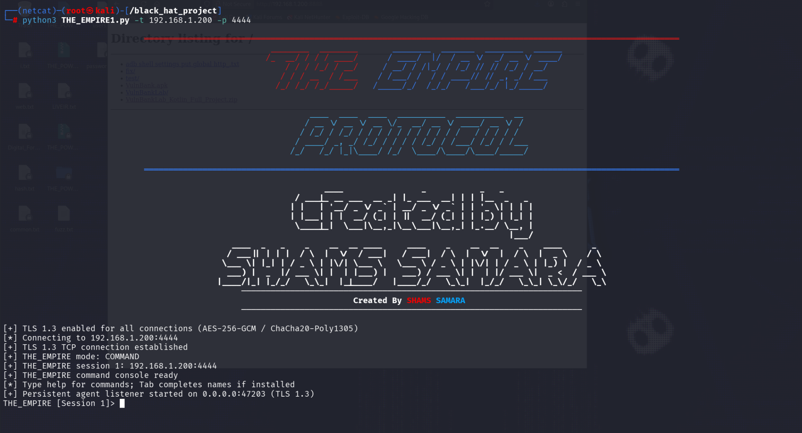
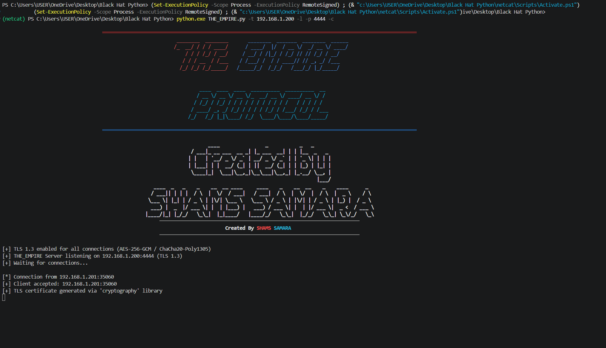
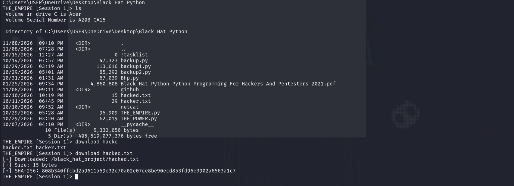
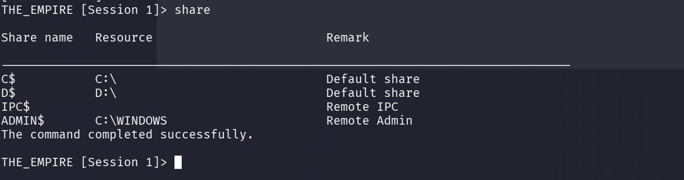

<div align="center">

# THE_EMPIRE
### Encrypted TCP Communication & Session Management — Python Research Project

**Developed by Shams Samara**


*A hands-on study of socket programming, encrypted transport, application-layer messaging, and interactive connection management.*

</div>

> [!IMPORTANT]
> **Authorized laboratory research only.** THE_EMPIRE is **not** a production-secure remote administration system. The current implementation has no effective agent authentication, does not verify TLS peer certificates, and includes an HTTP-based staging path. Do not expose it to untrusted networks. See [SECURITY.md](SECURITY.md).

## Contents

- [Overview](#overview)
- [Lab screenshots](#lab-screenshots)
- [Capabilities](#capabilities)
- [Architecture](#architecture)
- [Requirements](#requirements)
- [Local demo](#local-demo)
- [Command-line reference](#command-line-reference)
- [Technical details](#technical-details)
- [Security limitations](#security-limitations)
- [Repository layout](#repository-layout)
- [Ownership](#ownership)

## Overview

**THE_EMPIRE** is an educational Python networking project that combines TCP client/server communication, optional TLS 1.3 transport, message framing, connection/session handling, and file-transfer logic. It explores both byte-stream (`--raw`) and application-protocol modes.

It also contains a command/session framework and agent-related features. These are security-sensitive and must only be evaluated on systems for which the operator has explicit authorization. Some behaviors (such as process-name masking, relocation, and self-deletion) warrant extra scrutiny and are not necessary for the networking demo below.

### Demonstrated lab environment

| Component | Observation from the supplied screenshots |
| --- | --- |
| Client | Kali Linux terminal |
| Server | Windows PowerShell terminal |
| Transport | TLS 1.3 connection established |
| Tested endpoint | Private lab IPv4 address `192.168.1.200`, TCP port `4444` |
| Application mode | Interactive `COMMAND` session |
| Recorded operations | Directory listing, file download with SHA-256 display, Windows share listing |

**What this proves:** the screenshots show a working lab connection and selected features. They do **not** establish authentication, trusted peer identity, or the security of the entire application.

## Lab screenshots

### 1. Kali Linux — TLS 1.3 client and interactive session



The client reports a successful encrypted transport connection, `COMMAND` mode, and session ID `1`.

### 2. Windows — TLS listener and accepted connection



The server accepts the incoming connection and generates a self-signed TLS certificate using the Python `cryptography` package.

### 3. Cross-platform command aliases and file transfer



The `ls` alias produces a Windows directory listing, while a lab text file is downloaded to Kali. The console displays a size of **15 bytes** and a SHA-256 digest.

### 4. Windows network share listing



The command displays share names (for example `C$`, `D$`, `IPC$`, and `ADMIN$`) as returned by Windows. **Listing shares is not evidence of permission to access their contents.**

> The screenshots reflect an isolated user-provided test lab. Before making the repository public, review all images for visible usernames, file names, internal IP addresses, and other metadata.

## Capabilities

| Feature | Implementation notes |
| --- | --- |
| **TCP client/server** | Socket-based bidirectional connections |
| **TLS 1.3** | Default transport with self-signed certificate generation support; certificate identity is *not* verified by the client |
| **RAW streaming** | Unframed TCP byte stream mode alongside a framed application protocol |
| **Application protocol** | Four-byte big-endian message length with JSON-based requests in command mode |
| **Session manager** | Session IDs, selection, backgrounding, inspection, connection lifecycle |
| **File transfer** | Upload/download pathways with SHA-256 reporting in framed session mode |
| **Cross-platform aliases** | Mapping of selected commands for Windows and Unix-like hosts |
| **Interactive CLI** | Optional path and command completion using `prompt_toolkit` |
| **Logging** | Optional JSONL connection/event metadata |
| **Agent research code** | Auto-reconnect and related behavior; not suitable for deployment without extensive security review |

## Architecture

```text
                  THE_EMPIRE TCP / TLS 1.3

    Client                                        Server
  (Kali Linux)                               (Windows lab)
       |                                            |
       | -------- TCP connection / TLS ----------> |
       | <----------- Handshake ------------------- |
       |                                            |
       | ===== Application data over TLS ========> |
       | <======== Application responses ========= |
       |                                            |
  Session / CLI                            Protocol handler
  File transfers                           Local processing
```

**Two transport behaviors:**

1. **RAW mode:** sends and receives bytes without the application's length/JSON framing.
2. **Framed mode:** uses a 4-byte network-order length header, followed by the message body; command/session messages use JSON.

TLS protects supported socket traffic in transit, but the code's certificate-verification and authentication limitations remain critical.

## Requirements

- Python 3 with an environment supporting TLS 1.3.
- Windows or Linux for the demonstrated platforms.
- Optional: `cryptography` (automatic self-signed certificate generation), `prompt_toolkit` (Tab completion), `colorama` / `pyfiglet` (terminal display).

```bash
python -m pip install -r requirements-optional.txt
python THE_EMPIRE.py --help
```

## Local demo

The example below is an **Echo-only loopback test**. It does not expose an interactive shell or require access to another computer.

**Terminal A — local server**

```bash
python THE_EMPIRE.py --listen --target 127.0.0.1 --port 5555
```

**Terminal B — local client**

```bash
python THE_EMPIRE.py --target 127.0.0.1 --port 5555
```

Type a sample message in the client and observe the echoed response. Use `exit` to close the session.

## Command-line reference

| Option | Purpose |
| --- | --- |
| `-l`, `--listen` | Listen for incoming TCP connections |
| `-t`, `--target` | Target IP or local bind address; default `127.0.0.1` |
| `-p`, `--port` | TCP port; default `5555` |
| `--raw` | Unframed, bidirectional TCP stream |
| `--raw-echo` | Echo bytes received by a RAW listener |
| `--raw-message TEXT` | Send one UTF-8 message from a RAW client |
| `-c`, `--command` | Select the command-shell server mode (authorized labs only) |
| `-e`, `--execute` | Single-command server mode (authorized labs only) |
| `-u`, `--upload` | Receive a file at a specified server-side path |
| `-f`, `--file` | Select a local file to send |
| `--log PATH` | Append connection metadata to JSONL |
| `--upgrade-lhost IP` | Agent listener callback address (advanced, restricted research) |
| `--upgrade-lport PORT` | Agent listener callback port (advanced, restricted research) |
| `--no-tls` | Disable TLS; not recommended |

The `--raw` flag cannot be combined with the `--command`, `--execute`, `--upload`, or `--file` options.

In the interactive manager, `help` displays available commands. Basic session commands include `sessions`, `sessioninfo`, and `background`.

## Technical details

- **TLS:** configured for TLS 1.3 via Python's `ssl` module. Actual cipher selection depends on the TLS handshake.
- **Self-signed certificates:** generated dynamically using `cryptography` or the OpenSSL CLI if available.
- **Framing:** 4-byte length prefix; the primary protocol limits a frame to 16 MiB.
- **File transfer:** the primary session implementation limits transfers to 256 MiB and uses SHA-256 for integrity checks/reporting.
- **Concurrency:** Python threads are used for background listeners and connection-handling functions.
- **Logging:** optional JSONL metadata, not a complete forensic audit trail.
- **Reconnection:** the Python agent contains increasing delays and jitter; this does not itself establish persistence across reboots.

## Security limitations

1. **No meaningful authentication:** the agent handshake is not a strong authentication mechanism.
2. **No certificate verification:** client-side certificate validation and hostname checks are disabled.
3. **Mixed transport protections:** the staging/delivery HTTP endpoint is not protected by TLS.
4. **Sensitive capabilities:** remote command execution, file transfer, and agent behaviors can be misused.
5. **Not production-ready:** there is no independent security audit or comprehensive test suite provided.

For responsible-use and disclosure information, see [SECURITY.md](SECURITY.md).

## Repository layout

```text
THE_EMPIRE/
├── THE_EMPIRE.py
├── README.md
├── COPYRIGHT.md
├── SECURITY.md
├── .gitignore
├── requirements-optional.txt
└── docs/
    ├── README_AR.md
    ├── DEMO_NOTES.md
    └── screenshots/
        ├── 01-kali-tls-session.png
        ├── 02-windows-tls-listener.png
        ├── 03-remote-files-and-sha256.png
        └── 04-windows-share-enumeration.png
```

## Ownership

**Copyright © 2026 Shams Samara. All Rights Reserved.** No open-source license is granted. See [COPYRIGHT.md](COPYRIGHT.md). Third-party code, where present, remains subject to its original rights and terms.

**Arabic overview:** [اقرأ شرح المشروع بالعربية](docs/README_AR.md) · **Lab evidence:** [Demonstration notes](docs/DEMO_NOTES.md)
